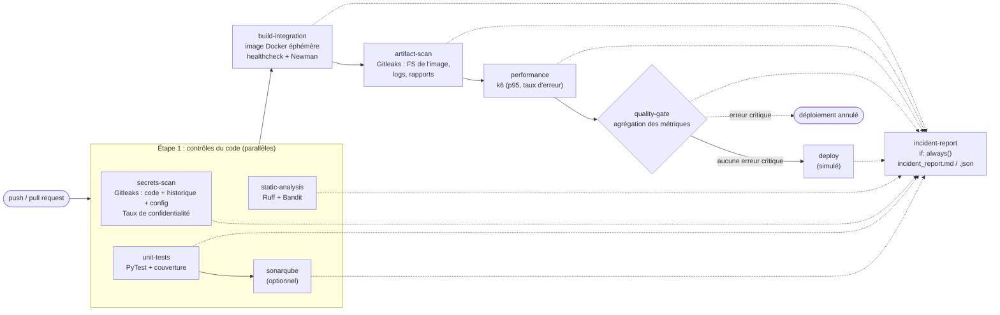

# Architecture du pipeline CI/CD et logique d'analyse des erreurs

## 1. Schéma du pipeline

Chaque job publie ses **métriques normalisées** (`metrics/*.json`) comme artefact GitHub Actions :

| Job | Outil brut | Rapport brut | Métriques normalisées |
|---|---|---|---|
| secrets-scan | Gitleaks (mode `git` + `dir`) | `gitleaks-source.json`, `gitleaks-config.json` | `confidentiality-source.json` |
| static-analysis | Ruff, Bandit | `ruff.json`, `bandit.json` | `static.json` |
| unit-tests | PyTest, pytest-cov | `junit.xml`, `coverage.xml`, HTML | `ut.json` |
| sonarqube | sonar-scanner + API Sonar | tableau de bord Sonar | `sonar.json` |
| build-integration | Docker Compose, Newman | `newman-junit.xml`, logs API | `it.json` |
| artifact-scan | Gitleaks (mode `dir`) | `gitleaks-artifacts.json` | `confidentiality-artifacts.json` |
| performance | k6 `--summary-export` | `k6-summary.json`, logs API | `perf.json` |

`scripts/collect_metrics.py` convertit les rapports bruts. `scripts/quality_gate.py` applique les seuils.

## 2. Classification des erreurs : critique ou non critique

| Indicateur | OK | Non critique (WARNING) | Critique (CRITICAL, fail fast) |
|---|---|---|---|
| Tests unitaires / intégration | 0 échec | - | au moins 1 test en échec |
| Couverture de code | C ≥ 80 % | 70 % ≤ C < 80 % | C < 70 % |
| Bugs / smells | 0 | code smells (Ruff, Bandit LOW/MEDIUM, Sonar) | bug bloquant : Bandit HIGH, Sonar BLOCKER/CRITICAL (bug/vulnérabilité), Ruff F821/F822/F823/F63x/F7xx/E9xx (nom indéfini, variable non affectée, erreur de syntaxe : l'équivalent Python d'une NullPointerException potentielle) |
| Performance : latence | p95 < 200 ms | 200 ms ≤ p95 ≤ 500 ms | p95 > 500 ms |
| Performance : erreurs | < 1 % | 1 % ≤ erreurs ≤ 2 % | > 2 % |
| Confidentialité | taux = 100 % | - | taux < 100 % (au moins une fuite) |
| Exécution d'un job | succès | - | job en échec sans métrique (build cassé, outil absent...) |

### Réaction du pipeline

* **Non critique** : le script renvoie le code 0, donc le job reste vert et le pipeline continue jusqu'au déploiement. L'alerte apparaît sous trois formes :
  * une annotation `::warning::` sur le run (ex. « Attention, couverture à 76.0 % (objectif 80 %) ») ;
  * une ligne 🟠 dans le résumé du job (`GITHUB_STEP_SUMMARY`) ;
  * une section « Erreurs non critiques » dans `incident_report.md`.
* **Critique** : le script renvoie le code 1, donc le job échoue. Comme chaque job suivant déclare `needs:` sur les précédents, GitHub Actions les **ignore** (*skipped*) : pas de Quality Gate global, **pas de déploiement**. Le job `incident-report` (`if: always()`) lit alors :
  * les métriques disponibles ;
  * le résultat de chaque job (`toJSON(needs)`).

  Il identifie la **cause racine**, c'est-à-dire la première erreur critique dans l'ordre du pipeline, et produit `incident_report.md` et `incident_report.json` avec les informations suivantes :
  * commit, branche, URL du run ;
  * job fautif, indicateur, valeur mesurée, seuil violé, classification ;
  * action recommandée ;
  * état de chaque job (succès, échec, annulé par le fail fast).

### Double niveau de contrôle

1. **Contrôle au plus tôt (fail fast)** : chaque job évalue son propre périmètre dès qu'il a ses mesures (`quality_gate.py evaluate --scope ut|it|perf|static`, `confidentiality.py`). L'outil lui-même échoue aussi sur le seuil critique : `pytest --cov-fail-under=70`, seuils k6 `p(95)<=500` et `rate<=0.02`, Newman en cas d'assertion fausse.
2. **Contrôle global** : le job `quality-gate` réagrège toutes les métriques et exige leur présence (`--require ut,it,perf,static,confidentiality`). Une métrique manquante est elle-même critique, ce qui empêche de valider un pipeline sur des données partielles.

Les seuils k6 sont binaires. Ils sont donc réglés sur les seuils **critiques** du sujet. La zone d'avertissement (200 à 500 ms) est calculée par `quality_gate.py` à partir du JSON exporté par k6.

## 3. Taux de confidentialité

$$\text{Taux} = \max\left(0,\ 1 - \frac{N_\text{fuites}}{\max(S_\text{max}, 1)}\right) \times 100\ \%,\qquad S_\text{max} = 0$$

La formule du sujet, `(1 - N / S_max) × 100`, est **indéterminée pour S_max = 0** (division par zéro). On remplace donc le dénominateur par `max(S_max, 1)` :

* 0 fuite donne 100 %, et le pipeline peut être validé ;
* au moins une fuite donne 0 %, ce qui est une erreur **critique** : arrêt immédiat.

Une fuite correspond à un triplet unique (règle, fichier, ligne). Les trois périmètres exigés sont scannés :

| Périmètre | Commande | Moment |
|---|---|---|
| Code source + **historique git** de la branche | `gitleaks git --log-opts="--full-history HEAD"` | job secrets-scan (étape 1) |
| Fichiers de configuration (Dockerfile, compose, `.env*`, `config/`, `.github/`, `postman/`, ...) | `gitleaks dir .scan/config` | job secrets-scan (étape 1) |
| Artefacts du build : système de fichiers de l'image (`docker export`), configuration de l'image, logs de l'API, rapports du pipeline | `gitleaks dir artifacts` | job artifact-scan (étape 3) |

Règles : toutes les règles par défaut de Gitleaks (clés cloud, tokens OAuth/GitHub/Slack, clés privées, JWT, ...), plus deux règles métier définies dans `.gitleaks.toml` :

* `pii-credit-card-pan` : numéro de carte Visa, Mastercard, Amex ou Discover en clair (avec ou sans séparateurs) ;
* `payflex-api-token` : jeton d'API PayFlex `pfx_live_...` / `pfx_test_...`.

Les rapports sont produits avec `--redact`, si bien que le secret n'est jamais recopié dans les artefacts. Une seule exception est autorisée, avec justification dans `.gitleaks.toml` : `GPG_KEY=<40 hex>`, l'empreinte **publique** de la clé du release manager CPython, présente dans l'image de base officielle `python:3.11-slim`.

## 4. Mesures de protection des données dans l'application

* Secrets fournis uniquement par l'environnement : clé JWT (aléatoire par défaut) et mot de passe du client de test, généré aléatoirement à chaque job CI et masqué avec `::add-mask::`.
* PAN masqués (`**** **** **** 1234`) dans les réponses, dans les logs (filtre de logging qui réécrit tout message) et dans les erreurs de validation (la valeur saisie n'est jamais renvoyée).
* Aucun numéro de carte en clair dans le dépôt : tests, collection Newman et script k6 génèrent leurs PAN de test à l'exécution, via l'algorithme de Luhn.
* Le scan des logs de l'API produits pendant les tests d'intégration vérifie en continu que le masquage fonctionne.
